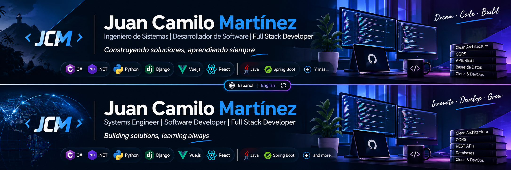

# 👋 Hi! I'm Juan Camilo Martínez

[🇨🇴 Español](README.md) · [🇺🇸 English](README.en.md)

  

  ### Systems Engineer | Software Developer | Full Stack Developer

  **Building solutions, learning continuously, and turning ideas into code.**

  
  
  

---

## 🧑‍💻 About Me

I'm a Systems Engineer passionate about software development, application architecture, and technology.

I focus on building functional, maintainable, and scalable solutions, participating in different stages of the software development lifecycle, from analysis and design to implementation, integration, and maintenance.

I have experience working with web applications, backend development, REST APIs, relational databases, and frontend technologies.

**Areas of interest:**

- Backend and Full Stack Development.
- REST API design and implementation.
- Software architecture and design patterns.
- Systems integration and automation.
- Database design and optimization.
- Artificial Intelligence applied to software development.
- Infrastructure, services, and application deployment.

## 🛠️ Tech Stack

### Backend

  

### Frontend

  

### Databases

  

### DevOps, Tools & Services

  

### Architecture & Fundamentals

- Clean Architecture.
- CQRS and Mediator Pattern.
- SOLID principles.
- Object-Oriented Programming (OOP).
- Entity Framework Core and Django ORM.
- MediatR, FluentValidation, and AutoMapper.
- JWT Authentication and Authorization.
- RESTful APIs and Swagger / OpenAPI.
- Version Control and Git Workflows.

## 🧠 Currently Exploring

- Scalable and modular software architectures.
- Artificial Intelligence and multi-agent systems.
- AI-powered process automation.
- Docker and Kubernetes.
- Linux, server administration, and Home Lab.
- Cloud infrastructure and application deployment.

## 🤝 Let's Connect

I'm open to professional opportunities, collaborations, and projects related to software development and technology.

  

  

  

  ---

  **💡 Learn · Design · Build · Improve**

  *"Software is not just about writing code; it's about building solutions."*

