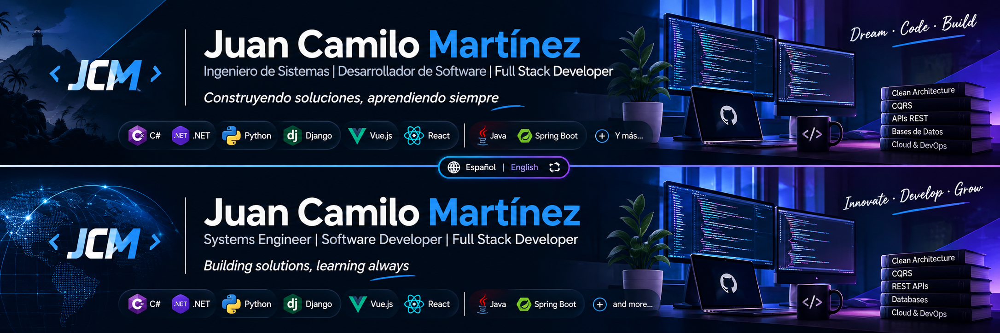

# 👋 ¡Hola! Soy Juan Camilo Martínez

[🇨🇴 Español](README.md) · [🇺🇸 English](README.en.md)

  

  ### Ingeniero de Sistemas | Desarrollador de Software | Full Stack Developer

  **Construyendo soluciones, aprendiendo continuamente y convirtiendo ideas en código.**

  
  
  

---

## 🧑‍💻 Sobre mí

Soy Ingeniero de Sistemas apasionado por el desarrollo de software, la arquitectura de aplicaciones y la tecnología.

Me enfoco en construir soluciones funcionales, mantenibles y escalables, participando en diferentes etapas del ciclo de desarrollo: desde el análisis y diseño hasta la implementación, integración y mantenimiento de aplicaciones.

Tengo experiencia trabajando con aplicaciones web, desarrollo backend, APIs REST, bases de datos relacionales y tecnologías frontend.

**Áreas de interés:**

- Desarrollo Backend y Full Stack.
- Diseño e implementación de APIs REST.
- Arquitectura de software y patrones de diseño.
- Integración de sistemas y automatización.
- Diseño y optimización de bases de datos.
- Inteligencia Artificial aplicada al desarrollo.
- Infraestructura, servicios y despliegue de aplicaciones.

## 🛠️ Stack tecnológico

### Backend

  

### Frontend

  

### Bases de datos

  

### DevOps, herramientas y servicios

  

### Arquitectura y fundamentos

- Clean Architecture.
- CQRS y Mediator Pattern.
- Principios SOLID.
- Programación orientada a objetos (POO).
- Entity Framework Core y Django ORM.
- MediatR, FluentValidation y AutoMapper.
- Autenticación y autorización mediante JWT.
- RESTful APIs y Swagger / OpenAPI.
- Control de versiones y flujos de trabajo Git.

## 🧠 Actualmente explorando

- Arquitecturas de software escalables y modulares.
- Inteligencia Artificial y sistemas multiagente.
- Automatización de procesos mediante IA.
- Docker y Kubernetes.
- Linux, administración de servidores y Home Lab.
- Infraestructura Cloud y despliegue de aplicaciones.

## 🤝 Conectemos

Estoy abierto a nuevas oportunidades profesionales, colaboraciones y proyectos relacionados con el desarrollo de software y la tecnología.

  

  

  

  ---

  **💡 Aprender · Diseñar · Construir · Mejorar**

  *"El software no se trata solamente de escribir código, sino de construir soluciones."*

